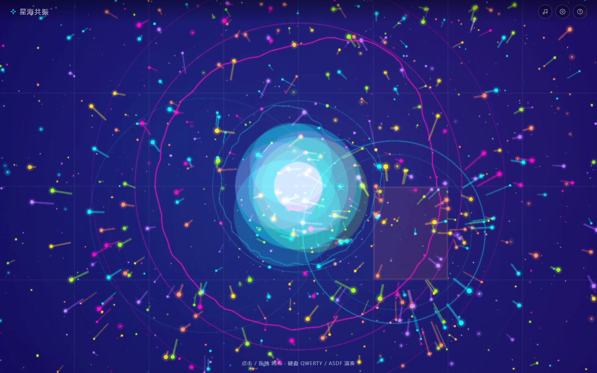
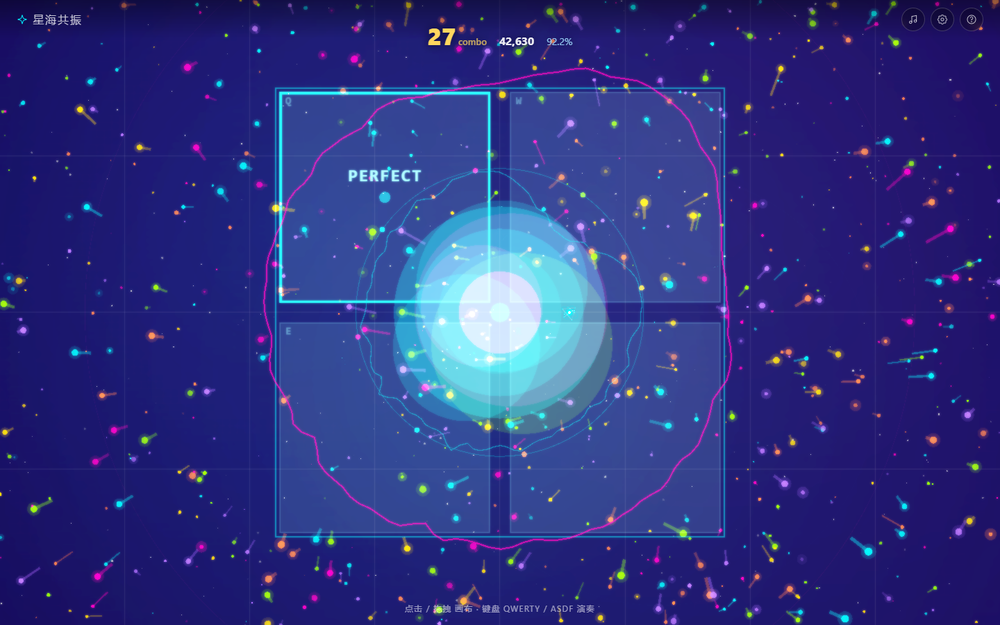
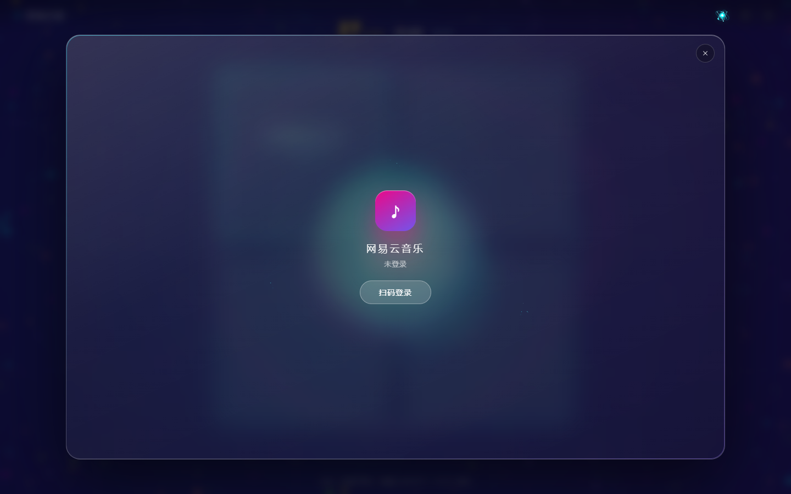
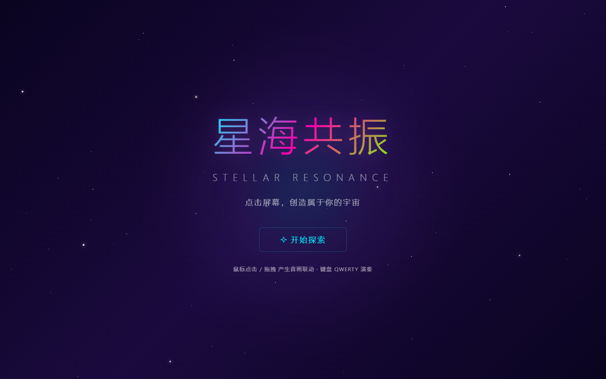
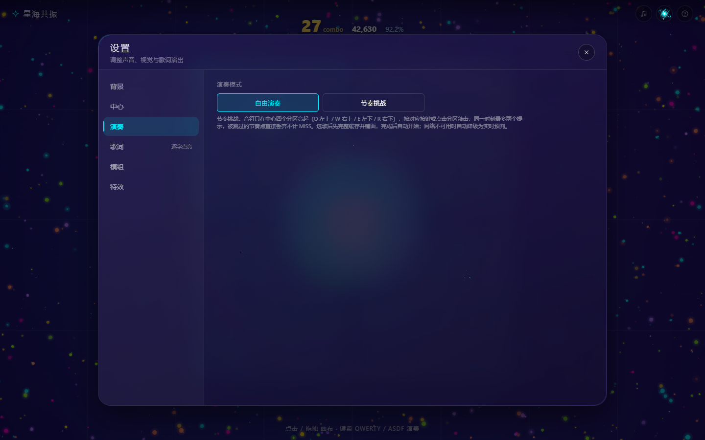

# MusicTap · 星海共振

> 把听歌时不自觉的抖腿，变成看得见的音画宇宙 —— Mikutap 式点击演奏 × 节奏挑战音游 × 网易云在线曲库 & Folia 歌词演出，每次触碰都是一个音符与一片星海。

MusicTap 是一个纯前端、无构建的网页音画作品：点击或拖拽画布即兴演奏，粒子、波纹与频谱随声音生长；切到「节奏挑战」，它又变成一款能从任意歌曲自动生成谱面的音游——先完整缓存歌曲，再用 FFT 起振点分析离线铺面，四分区光框随节拍收缩；接入网易云后，还可以扫码登录、搜索歌曲、加载逐字歌词，并把这套歌词演出投射到整个星海背景里。

全部依赖已本地化，断网也能运行合成器、离线谱面与歌词演出。

## 预览

| 点击演奏 | 节奏挑战（音游模式） |
| --- | --- |
|  |  |

| 网易云播放器 | 欢迎页 |
| --- | --- |
|  |  |

设置面板（演奏参数 · 难度 · 判定 · 节拍脉冲辅助）：



## 功能特性

**演奏与视觉**

- 鼠标点击 / 拖拽连续发声，Y 轴映射音高、X 轴映射声像
- QWERTY / ASDF 键盘演奏，全键盘随机触发
- 6 种实时合成音色：泛音叠加、正弦波、方波、三角波、锯齿波、白噪声（纯 Web Audio API，零音频素材）
- 粒子物理（密度 / 寿命 / 初速 / 引力）、波纹、连线星座、环形频谱
- 背景模式 12 种：通用、星云（哈勃船底座星云）、极光（ISS 南极光）、穿梭，以及 8 种星海共振——引力吸积盘、声波涟漪干涉、克拉德尼驻波、李萨如电子束、极光帷幕、流场丝线、星座连线网络、拓扑等高线
- 中心特效 5 种：流体核心（心电双轮廓 + 节拍声呐）、频谱花冠（64×2 镜像频谱条，每次击键换色）、液态呼吸、音频多面体、关闭
- 重力场、鼠标斥力、FlowField 流场、Mesh 重组、Metaball、Bloom 等 13 个可独立开关的特效

**节奏挑战（音游模式）**

- **先缓存再铺面**：音游模式下选歌，先把歌曲完整缓存到本地（Cache API，LRU 24 首），再用离线谱面引擎铺面；缓存失败 / 断网自动降级为在线实时预判铺面
- **离线谱面生成**：AudioBuffer 降采样 → 自研 radix-2 FFT → 三频段 spectral flux 起振点检测 → IOI 直方图估计 BPM（±5% 梳状精化）→ 相位对齐 → 16 分格量化 → 按难度生成谱面；谱面与音频缓存复用，二刷秒开
- **四分区玩法**：音符只在中心 2×2 四分区（Q 左上 / W 右上 / E 左下 / R 右下）亮起，按对应按键或点击分区敲击，触屏可玩；光框收缩到贴合分区时为判定正点
- **判定系统**：PERFECT / GREAT / GOOD / MISS 四档窗口，结算卡给出 S / A / B / C / D 评级、最大连击与准确率
- **难度三档**：轻松（光框收缩慢约 35%，新手友好）/ 标准 / 激烈；轻松与标准同屏最多 1 个待敲提示（上一拍没敲完不会派新的），激烈最多 2 个；被挤掉的节奏点直接丢弃不计 MISS
- **判定辅助**：中心节拍脉冲（拍点爆亮 + 脉冲环 + 分区外框呼吸），只提示「什么时候该敲」，帮助建立节奏感，可在设置中关闭
- **连击里程碑演出**：10 / 25 / 50 及其后每 50 连击，全屏轻闪 + 中心冲击波 + 上扬琶音 + HUD 数字弹跳
- **打击反馈**：命中时分区网格高亮同款爆闪 + 分档打击音效层（PERFECT = 808 底鼓 + 高频 snap），判定文字同屏只保留最新一条、按下即快速淡出
- **调校项**：宽松判定（任意分区都算命中）、判定偏移 ±200ms（补偿蓝牙耳机延迟）；每次进入页面默认自由演奏
- 严格时间同步：媒体时钟（audio.currentTime + performance.now 线性外推）、开场预卷（Audio Lead-In）、过期提示当帧出队不积压

**网易云音乐**

- 扫码登录，Cookie 本地保存
- 搜索歌曲、读取我的歌单、播放本地音频文件
- LRC / 增强 LRC / YRC 逐字歌词、翻译字幕、下一句提示、关键词着色
- 队列模式：顺序 / 随机 / 单曲循环
- AI 主题：根据封面主色与歌词情绪生成配色与粒子参数
- 正在播放的歌曲在曲库列表中高亮，并带呼吸灯提示

**歌词演出**

- 14 种内置演出模式：关闭、经典单行、逐字点亮，以及从 Folia 移植的 11 种场景
- 其中 7 种为沉浸式（浮名、莫奈、回环、镜台、时计、商籁、凝彩），会覆盖画布只保留歌词与氛围
- 通用参数（字体 / 字号 / 透明度）与逐模式参数，实时生效
- 模组系统：经典脚本模组（`mods/<id>/mod.js`）与原生 Folia ESM 模组（`mods/<id>/client.js`）都可用

**已内置模组**

| 模组 | 版本 | 作用 |
| --- | --- | --- |
| `sample-glow` | 0.1.0 | 示例模组：当前句居中，光晕随音频能量呼吸 |
| `wave-light` | 1.5.1 | 动感波光（沉浸式）：封面主色波光 + 层中歌词 + 关键字水印 + 翻译 |
| `vinyl-disc` | 1.7.10 | 黑胶唱片：封面当碟心，播放时唱片旋转、唱臂落下，暂停即停转 |
| `cinerama` | 1.0.0 | 巨幕歌词：大字报、跑马灯带、斜切丝带，像 LED 大屏一样呈现 |
| `k3panel` | 1.0.1 | 商籁深度精调：给商籁追加相机、逐字运动、视差、转场等 11 个倍率参数 |

> ESM 模组通过动态 `import()` 加载。用 `file://` 直接打开时浏览器会拦截模块脚本，这三个模组会被跳过；用本机或局域网 `http://` 打开即可正常加载。原生模组已从 `.mjs` 改为 `.js`（Python 自带的静态服务器不识别 `.mjs` 的 MIME 类型）。

**界面与可访问性**

- 玻璃质感双卡片：网易云播放器（舞台 + 340px 控制轨 + 传输台）与设置（7 项左导航）
- 两窗互斥打开、播放不中断；播放器头部可直接进入设置
- 打开窗口时用兄弟节点 `inert` 隔离焦点，关闭后焦点归还触发按钮
- 设置导航支持 ↑↓ / ←→ / Home / End，队列与抽屉用 `aria-expanded` 表达状态
- 尊重 `prefers-reduced-motion`，小屏时右侧栏变为底部抽屉

## 快速开始

### 方式一：直接打开

用浏览器打开 `index.html` 即可体验点击演奏（无需联网，无需构建；本地音频的节奏挑战与模组需 `http://` 打开）。

### 方式二：本机启动

在仓库根目录执行（任意静态服务器都可以）：

```bash
python -m http.server 8080
# 或：npx http-server . -p 8080
```

浏览器访问 <http://localhost:8080/>。

### 方式三：局域网启动（手机 / 另一台电脑访问）

手机调试推荐用这条命令，让静态服务监听所有网卡：

```bash
python -m http.server 8080 --bind 0.0.0.0
```

1. 查本机局域网 IP
   - Windows：`ipconfig`，看「无线局域网适配器 WLAN → IPv4 地址」
   - macOS / Linux：`ifconfig` 或 `ip addr`，看 `192.168.x.x` / `10.x.x.x`
2. 手机与电脑连同一个 Wi-Fi
3. 手机浏览器打开 `http://<电脑IP>:8080/`，例如 `http://192.168.1.8:8080/`

注意事项：

- Windows 首次启动会弹防火墙提示，勾选「专用网络」并允许访问
- 打不开时先确认命令里带了 `--bind 0.0.0.0`，再用手机访问同一 IP 的 8080 端口验证
- 路由器开启「AP 隔离 / 访客网络」时，同一 Wi-Fi 下的设备也互相不可见，需要关闭该选项
- 手机端会自动进入响应式布局：播放器右侧控制栏变成底部抽屉（「控制」按钮打开），设置卡片导航变横向

### 可选：启用网易云在线曲库

播放器通过 [NeteaseCloudMusicApi](https://github.com/Binaryify/NeteaseCloudMusicApi) 访问网易云接口：

```bash
git clone https://github.com/Binaryify/NeteaseCloudMusicApi.git
cd NeteaseCloudMusicApi
npm install
node app.js        # 监听 0.0.0.0:3000
```

启动后在页面打开「网易云播放器 → 扫码登录」，即可搜索、加载歌单与歌词。

前端会自动把接口地址解析为「当前页面主机名 + `:3000`」：

| 访问方式 | 实际请求的接口 |
| --- | --- |
| `http://localhost:8080/` | `http://localhost:3000` |
| `http://192.168.1.8:8080/`（手机） | `http://192.168.1.8:3000` |

需要自定义时，用两种方式之一覆盖（优先级从高到低）：

```text
http://192.168.1.8:8080/?api=http://192.168.1.8:3000      # 单次生效
localStorage.setItem('uta.apiBase', 'http://192.168.1.8:3000')  # 长期生效
```

其他提示：

- 手机访问时后端也必须监听 `0.0.0.0`，并在防火墙放行 3000 端口
- 页面用 HTTPS 打开（如 GitHub Pages）时，浏览器会拦截 `http://` 接口，需要给后端配 HTTPS
- 若控制台报 CORS 错误，给后端加跨域头，或按「自有服务器」一节用同源反向代理 + `?api=/api`
- 播放器需要浏览器允许自动播放（首次点击页面后才会有声音）
- 未启动后端时，点击演奏、离线谱面、背景与歌词演出等离线功能不受影响

## 使用方法

**自由演奏**（默认模式）

| 操作 | 效果 |
| --- | --- |
| 鼠标点击画布 | 触发音效 + 粒子爆发 + 波纹 |
| 鼠标拖拽 | 连续发声，持续喷射粒子 |
| 键盘 QWERTY / ASDF | 模拟钢琴演奏 |
| Y 轴位置 | 映射音高（上高下低） |
| X 轴位置 | 映射声像（左右声道） |
| 工具栏 ♪ | 打开网易云播放器 |
| 工具栏 ⚙ | 打开设置 |
| 工具栏 ? | 关于 |
| ESC | 关闭当前窗口 |

**节奏挑战（音游模式）**

1. 打开「设置 ⚙ → 演奏 → 演奏模式」，选择「节奏挑战」
2. 选一首歌（网易云在线曲目或本地音频文件）：页面会先显示「正在缓存歌曲 → 正在铺面中」，完成后自动开始；断网时自动切换实时预判铺面
3. 音符在中心四个分区亮起，光框收缩到**贴合分区边框**的瞬间就是判定正点：
   - 键盘：**Q 左上 / W 右上 / E 左下 / R 右下**
   - 触屏 / 鼠标：直接点击亮起的分区（等效按键）
4. 结束后弹出结算卡：评级、得分、最大连击、准确率与四档判定分布
5. 建议新手路径：难度选「轻松」、开启「宽松判定」与「节拍脉冲辅助」先练手感，再逐步上调难度

调校项（设置 → 演奏 → 节奏挑战参数）：

| 参数 | 说明 |
| --- | --- |
| 难度 | 轻松（收缩慢 35%、1 个提示）/ 标准（1 个提示）/ 激烈（2 个提示，节奏更密） |
| 判定偏移 | ±200ms；蓝牙耳机延迟大就调正值，感觉总比音乐早/晚也可微调 |
| 宽松判定 | 任意分区都算命中（不判「敲错分区」） |
| 节拍脉冲辅助 | 中心点随节拍闪动，提示「什么时候该敲」；熟练后可关闭 |

## 目录结构

```
MusicTap/
├── index.html            # 单页入口（欢迎页 / 画布 / 设置 / 播放器 / 关于 / 音游 HUD 与结算卡）
├── css/
│   └── utatap.css        # 全部样式（玻璃卡片、音游 HUD、结算卡与响应式）
├── js/
│   ├── main.js           # 主控制器：场景、事件、设置、窗口焦点、音游输入接线
│   ├── audioEngine.js    # Web Audio 合成音色
│   ├── djFxEngine.js     # BGM 音序器、FX 总线、命中打击音效与连击里程碑音效
│   ├── rhythmGame.js     # 节奏挑战引擎：先缓存再铺面编排、四分区调度、判定与结算
│   ├── chartBuilder.js   # 离线谱面生成：FFT 起振点检测 → BPM → 16 分格量化谱面
│   ├── beatGrid.js       # 在线实时预判：节拍网格学习与置信度
│   ├── gridLayer.js      # 网格层 + 中心 2×2 四分区（光框 / 判定字 / 节拍脉冲 / 里程碑演出）
│   ├── particleSystem.js # 粒子物理
│   ├── rippleEffect.js   # 波纹
│   ├── spectrumVisualizer.js
│   ├── parallaxStarfield.js
│   ├── bgLayer.js        # 背景模式系统（含 8 种星海共振与壁纸）
│   ├── stellarResonance.js  # 星海共振渲染引擎（引力吸积盘 / 克拉德尼 / 李萨如等 8 变体）
│   ├── coreLayer.js      # 中心特效（流体核心 / 频谱花冠 / 液态呼吸 / 音频多面体）
│   ├── flowField.js / meshReformer.js / metaballRenderer.js
│   ├── lyrics.js         # LRC / 增强 LRC / YRC 解析
│   ├── lyricTiming.js    # 行结束时间与逐字时序
│   ├── lyricStage.js     # 歌词演出渲染层
│   ├── lyricFlow.js      # 歌词流动控制
│   ├── builtinLyricModes.js  # 11 种 Folia 演出场景
│   ├── lyricTunings.js   # 通用 / 逐模式参数
│   ├── modHost.js        # 模组宿主（visualizers / tunings 注册表）
│   ├── modLoader.js      # ESM 模组加载桥（动态 import）
│   ├── netease.js        # 网易云 API 封装（含音频缓存 / 解码 / 播放）
│   ├── player.js         # 播放队列与歌词同步
│   ├── player-ui.js      # 播放器 UI 绑定
│   └── themes.js
├── img/                  # 背景壁纸（NASA 公版：船底座星云 / 南极光）
├── mods/
│   ├── sample-glow/      # 示例模组：声光歌词（经典脚本）
│   ├── wave-light/       # 动感波光（经典脚本）
│   ├── vinyl-disc/       # 黑胶唱片（ESM）
│   ├── cinerama/         # 巨幕歌词（ESM）
│   └── k3panel/          # 商籁深度精调（ESM tunings）
├── vendor/               # jQuery / PIXI / pixi-filters（本地化）
├── docs/                 # README 预览图
├── LICENSE
└── README.md
```

## 技术栈

| 层 | 选择 |
| --- | --- |
| 渲染 | PIXI.js v6（WebGL），自研插值动画 |
| 音频 | Web Audio API 实时合成 + AudioBufferSourceNode / MediaElementSource |
| 音游 | 自研 radix-2 FFT 起振点检测、媒体时钟线性外推（A Tale of Two Clocks）、Cache API 音频/谱面缓存 |
| 后处理 | pixi-filters（Bloom） |
| DOM | jQuery 3.6，无框架、无构建、经典 `<script>` |
| 歌词 | LRC / 增强 LRC / YRC 解析 + 自研时序与演出注册表 |

## 部署

### GitHub Pages（公网静态站点）

1. Settings → Pages → Source 选择 `Deploy from a branch`
2. Branch 选 `main`，目录选 `/ (root)`
3. 打开 Pages 给出的地址即可

Pages 走 HTTPS，网易云接口必须同样是 HTTPS，否则会被浏览器拦截。

### 局域网（另一台电脑 / 手机）

```bash
# 在仓库根目录
python -m http.server 8080 --bind 0.0.0.0
```

- 同一 Wi-Fi 的设备访问 `http://<本机IP>:8080/`
- 需要在线曲库时，`NeteaseCloudMusicApi` 也要监听 `0.0.0.0:3000`
- 前端会自动用「页面主机名 + :3000」请求接口，无需改代码；特殊情况用 `?api=` 覆盖

### 自有服务器

把仓库根目录整个上传到任意静态托管（Nginx / Caddy / OSS / Vercel 均可），示例 Nginx：

```nginx
server {
    listen 80;
    server_name music.example.com;
    root /var/www/MusicTap;
    index index.html;

    location /api/ {
        proxy_pass http://127.0.0.1:3000/;
        proxy_set_header Host $host;
    }
}
```

同源反向代理后，用 `?api=/api` 让前端走代理即可。

## 已知限制

- 网易云接口依赖第三方后端，部分网络环境下登录态会被风控，需要重试或调整 `realIP` 参数
- 在线播放要求后端能返回可用的 `song/url`，VIP / 版权受限歌曲可能无法播放
- 节奏挑战的谱面由算法自动生成，鼓点不明显的纯人声 / 古典曲目铺面质量会下降，此时判定辅助与宽松判定更实用
- 移动端横向空间有限，播放器右侧控制栏会改为底部抽屉
- 歌词演出对性能敏感，低端设备建议在设置中开启「性能模式」

## 致谢

本项目站在这些作品与项目的肩膀上：

- [uta-tap](https://github.com/MrXiaoM/uta-tap) —— 点击演奏与 UI 框架的原型，本项目在其基础上重构了视觉系统、歌曲播放与节奏挑战能力
- [Mikutap](https://aidn.jp/mikutap/)（daniwell / Aidn）—— 点击即演奏的交互范式
- [folia-major](https://github.com/Masterq8/folia-major) —— 歌词演出与模组系统的设计参考
- visualizer52hz、wave-light —— 歌词演出模组来源
- vinyl-disc（pomepii）、cinerama（tumuyan）、k3panel —— Folia 社区模组，已适配本项目的模组宿主
- [NeteaseCloudMusicApi](https://github.com/Binaryify/NeteaseCloudMusicApi) —— 网易云接口服务
- 节奏挑战的同步与铺面设计参考了 osu!（Audio Lead-In、combo milestone、beat meter）、Chris Wilson《A Tale of Two Clocks》与经典 onset detection 文献
- 背景壁纸来自 NASA 公版影像（哈勃 · 船底座星云；ISS · 南极光），见 `img/CREDITS.txt`

各模组的版权与许可证见 `mods/<id>/` 目录内的说明文件。

README 中的播放器与音游截图使用演示数据，非真实账号内容。

## 许可证

本项目基于 uta-tap 改造，沿用 [AGPL-3.0](LICENSE) 许可证。你可以自由使用、修改与分发，但衍生作品与网络服务也需要以相同许可证开源。
